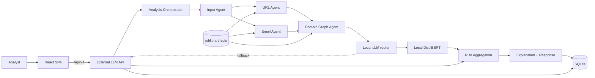

# PhishGuard AI

**Real-Time AI/ML-Based Phishing Detection and Prevention System**
SIH Problem Statement **SIH25159** · organisation **AICTE** · academic project **CSE473**

PhishGuard AI analyses a suspicious email or URL and returns a transparent **0–100 risk score**, a
classification (safe / suspicious / phishing), the evidence that produced it, and a recommended
action. It combines a genuine TF-IDF email classifier, a hostname-aware URL classifier,
deterministic threat rules, NetworkX domain-graph analytics, and an optional LLM layer. A React
dashboard exposes the whole analysis, including per-module scores and weights.

> **No fabricated numbers.** Every metric in this repository and report comes from an actual
> training/evaluation run recorded in `backend/artifacts/metrics.json`. Every dashboard number is
> computed from real stored scans. Submitted URLs are **parsed as text only** and are never fetched.

---

## 1. What it does

| Capability | Implementation |
|---|---|
| Email phishing detection | TF-IDF word 1–2 grams + Logistic Regression (scikit-learn) |
| URL phishing detection | Hostname character 3–5 gram TF-IDF + host-centric numeric features + Logistic Regression |
| Popularity prior | Cisco Umbrella top-1M ranking (`is_popular_domain`), with a documented calibration for bare top-ranked domains |
| Deterministic rules | Brand impersonation, IP hosts, punycode, userinfo, shorteners, high-abuse TLDs, credential keywords, anchor mismatch, attachment/urgency/payment language |
| Domain graph | NetworkX graph of hostnames, registrable domains, brands and malicious-corpus labels; **not a GNN**, no WHOIS/DNS/live reputation |
| Local LLM | Fine-tuned DistilBERT (66M) text classifier running on this machine (RTX 3050 / CPU); private by default, never sends email off-machine |
| External LLM (optional) | OpenAI-compatible `/chat/completions` fallback, disabled by default, strict JSON schema, prompt-injection resistant |
| Risk aggregation | Weighted mean over available modules (weights renormalised), capped corroboration bonus, thresholds 30/60/80 |
| Storage | SQLite + SQLAlchemy 2; short summary + derived indicators only, never the full email body |
| Dashboard | React + Vite + TypeScript + Tailwind + Recharts + Lucide |

### Honest headline results (held-out test set)

| Model | Test accuracy | Precision | Recall | F1 | ROC-AUC |
|---|---:|---:|---:|---:|---:|
| Email (TF-IDF + LR) | 0.9889 | 0.9963 | 0.9680 | **0.9819** | 0.9991 |
| URL (host char n-grams + LR) | 0.7475 | 0.7652 | 0.7170 | **0.7403** | 0.8421 |

The URL task is deliberately hard and the model is **not** production-grade: corpus bias makes
benign URLs and malicious URLs separable only to a limited degree using lexical host features. The
report and the in-app *About & Limits* page disclose this. A ComplementNB baseline matched the email
model on test F1 (0.9838 vs 0.9819); the LR model was retained as the pre-specified, explainable
model whose token contributions are surfaced in the UI.

---

## 2. Architecture



Detailed diagrams live in [`docs/diagrams/`](docs/diagrams/): system context, pipeline, email/URL
flows, risk aggregation, ER model, LLM sequence and deployment.

---

## 3. Quick start

### Prerequisites

- Python **3.11** (the project was built and tested with 3.11.15)
- Node.js 20+ and npm
- ~2 GB free disk for datasets and dependencies

### 3.1 Backend

```bash
# from the repository root
python3.11 -m venv .venv
.venv/bin/pip install -r backend/requirements-dev.txt

cd backend
cp ../.env.example ../.env        # optional; defaults already work
```

#### Local LLM (optional but enabled by default)

The private semantic component is a DistilBERT classifier fine-tuned on the real email corpus. It
runs locally and never sends content to an external service. Install the extra stack and train it
on the GPU:

```bash
.venv/bin/pip install -r backend/requirements-llm.txt
.venv/bin/python backend/scripts/train_local_llm.py   # ~5-10 min on RTX 3050 4 GB
```

This writes `backend/artifacts/local_llm/` and `backend/artifacts/local_llm_metrics.json` with real
held-out metrics. If the artifact is missing, that component is reported as `unavailable` and simply
excluded from the risk score. Set `LOCAL_LLM_ENABLED=false` to switch it off. The external API
fallback remains opt-in (`LLM_ENABLED=true` **and** `LLM_API_KEY=...`).

The repository ships **pre-trained artifacts** in `backend/artifacts/`. To rebuild them from the
public datasets:

```bash
cd backend
../.venv/bin/python scripts/download_datasets.py   # network required
../.venv/bin/python scripts/build_datasets.py
../.venv/bin/python scripts/train_models.py         # writes artifacts/metrics.json
../.venv/bin/python scripts/build_graph.py
../.venv/bin/python scripts/train_local_llm.py      # writes artifacts/local_llm/ + local_llm_metrics.json
```

Run the API:

```bash
cd backend
../.venv/bin/uvicorn app.main:app --host 127.0.0.1 --port 8000
```

- API docs: <http://127.0.0.1:8000/docs>
- Health: <http://127.0.0.1:8000/api/v1/health>

### 3.2 Frontend

```bash
cd frontend
npm install
npm run dev        # http://localhost:5173, proxies /api to :8000
```

Production build (also served by FastAPI when `frontend/dist` exists):

```bash
cd frontend
npm run build
```

Then `http://127.0.0.1:8000/` serves the built SPA.

### 3.3 Populate the demo dashboard with real scans

With the backend running:

```bash
python3 scripts/seed_demo.py
```

This calls `/api/v1/analyze/*` for 12 documented scenarios and writes their real outputs to
[`docs/demo_results.json`](docs/demo_results.json). It never inserts rows directly.

---

## 4. API

All endpoints are prefixed with `/api/v1`.

| Method | Path | Purpose |
|---|---|---|
| `GET` | `/health` | Service, database and artifact readiness |
| `GET` | `/models/status` | Artifact algorithms, metrics, LLM disclosure |
| `POST` | `/analyze/email` | Analyse email subject/body/sender/optional URLs |
| `POST` | `/analyze/url` | Analyse one URL string |
| `GET` | `/scans` | Paginated history with search/verdict/type filters |
| `GET` | `/scans/{id}` | Stored scan detail |
| `GET` | `/dashboard/stats` | Aggregate dashboard statistics |
| `GET` | `/dashboard/trend?days=N` | Daily scan/phishing trend |

Example:

```bash
curl -s -X POST http://127.0.0.1:8000/api/v1/analyze/url \
  -H 'Content-Type: application/json' \
  -d '{"url":"http://paypal-secure-login.xyz/verify-account"}'
```

Response fields include `risk_score`, `risk_level`, `classification`, `model_confidence`,
`components[]` (score, confidence, weight, contribution, explanation), `indicators[]`,
`url_results[]`, `explanation`, `recommendation` and privacy notices. Full schemas are in
`backend/app/schemas/analysis.py`.

---

## 5. Tests

```bash
cd backend
../.venv/bin/pytest -q        # 75 tests, ~15 s, fully offline
```

The suite covers URL parsing/features/rules, risk aggregation, model loading and inference,
popularity calibration, graph analytics, API validation, persistence, dashboard queries, pipeline
degradation with missing artifacts, and the optional LLM failure/validation paths.

```bash
cd frontend
npm run build                 # TypeScript check + Vite production build
```

---

## 6. Datasets and licences

| Dataset | Use | Licence |
|---|---|---|
| [Nazario Phishing Corpus 2019–2025](https://monkey.org/~jose/phishing/) | Phishing emails | CC-BY-4.0 |
| [SpamAssassin Public Corpus](https://spamassassin.apache.org/old/publiccorpus/) (easy/hard ham) | Legitimate emails | Apache SpamAssassin corpus terms |
| [Malicious URLs Dataset (Kaggle)](https://www.kaggle.com/datasets/sid321axn/malicious-urls-dataset) | Benign + phishing URLs | CC0 1.0 (dataset metadata) |
| [Phishing.Database](https://github.com/Phishing-Database/Phishing.Database) | Recent malicious URLs | CC0-1.0 |
| [Cisco Umbrella top-1M](https://s3-us-west-1.amazonaws.com/umbrella-static/top-1m.csv.zip) | Popularity prior only | Public ranking |

Raw and processed data are **not committed**; download/build scripts reproduce them. No URL was
fetched while building these datasets. See [`docs/methodology.md`](docs/methodology.md) for the
exact cleaning, split and artefact-control steps.

---

## 7. Repository layout

```
.
├── backend/
│   ├── app/
│   │   ├── agents/        # pipeline stages (input, url, email, domain, semantic, aggregation, explanation, response)
│   │   ├── api/           # routers + dependencies
│   │   ├── core/          # settings + logging
│   │   ├── database/      # engine/session
│   │   ├── graph/         # graph helpers
│   │   ├── ml/            # artifacts registry, URL features, popularity
│   │   ├── models/        # SQLAlchemy entities
│   │   ├── nlp/           # email text features + rules
│   │   ├── schemas/       # Pydantic v2 contracts
│   │   ├── services/      # url/email/graph/llm/risk/scan services
│   │   └── main.py
│   ├── tests/             # 75 offline tests
│   ├── scripts/           # download, build, train, graph
│   ├── artifacts/         # trained models + metrics (generated)
│   └── datasets/          # raw/processed data (generated)
├── frontend/src/          # React dashboard
├── docs/                  # architecture, methodology, API, testing, limitations, diagrams, report
├── scripts/seed_demo.py   # real scans via the API
└── context files (AGENTS.md, PROJECT_CONTEXT.md, PROJECT_STATUS.md, TASKS.md, DECISIONS.md, CHANGELOG.md)
```

---

## 8. Configuration and privacy

- No API keys or secrets in source. All configuration is environment-based; see `.env.example`.
- LLM analysis is **off by default**. When `LLM_ENABLED=true` and `LLM_API_KEY` is set, email content
  is sent to the configured provider and every response explicitly discloses it.
- Full email bodies are not persisted: only a ≤180-character summary, an input hash and derived
  indicators/components are stored.
- URLs are never requested, resolved or executed. No WHOIS/DNS/threat-intel enrichment is performed.
- The graph is a static corpus snapshot; absence of graph data is reported as `no_data`, not as
  evidence of safety.

---

## 9. Limitations (short list)

1. Email test data combines a 2003 legitimate corpus with 2019–2025 phishing; the temporal mismatch
   can inflate measured accuracy.
2. URL lexical detection generalises poorly; false positives on unseen legitimate hosts are expected.
3. Free-hosting platforms and URL shorteners are inherently ambiguous from lexical features alone.
4. The graph is offline and static; no live reputation, redirects, page content or attachments.
5. Thresholds and weights are product heuristics, not scientifically calibrated probabilities.

Full discussion: [`docs/limitations.md`](docs/limitations.md).

---

## 10. Documentation and deliverables

- [Architecture](docs/architecture.md) · [Methodology](docs/methodology.md) · [API](docs/api_documentation.md) · [Testing](docs/testing.md) · [Limitations](docs/limitations.md)
- [Mermaid diagrams](docs/diagrams/)
- [Demo scenarios and real outputs](docs/demo_results.json) · [screenshots](docs/screenshots/)
- Academic report: `docs/report/PhishGuard_AI_Report.docx` (+ PDF)
- Presentation: `docs/presentation/PhishGuard_AI_Presentation.pptx`
- Viva notes and demo script: `docs/viva_notes.md`, `docs/demo_script.md`
# phisguard-ai
