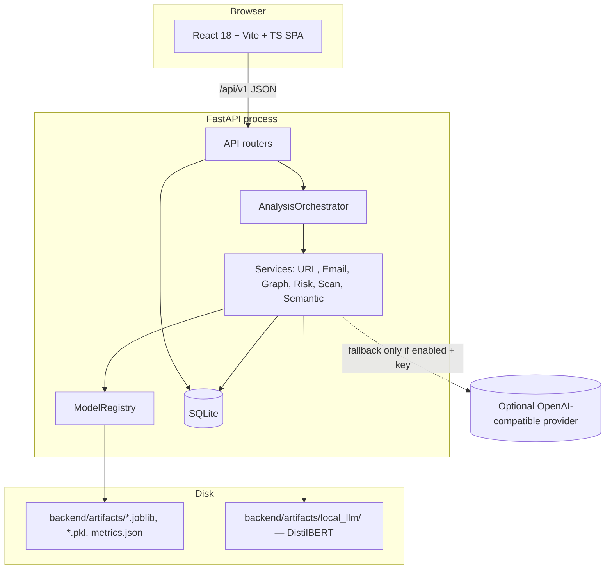
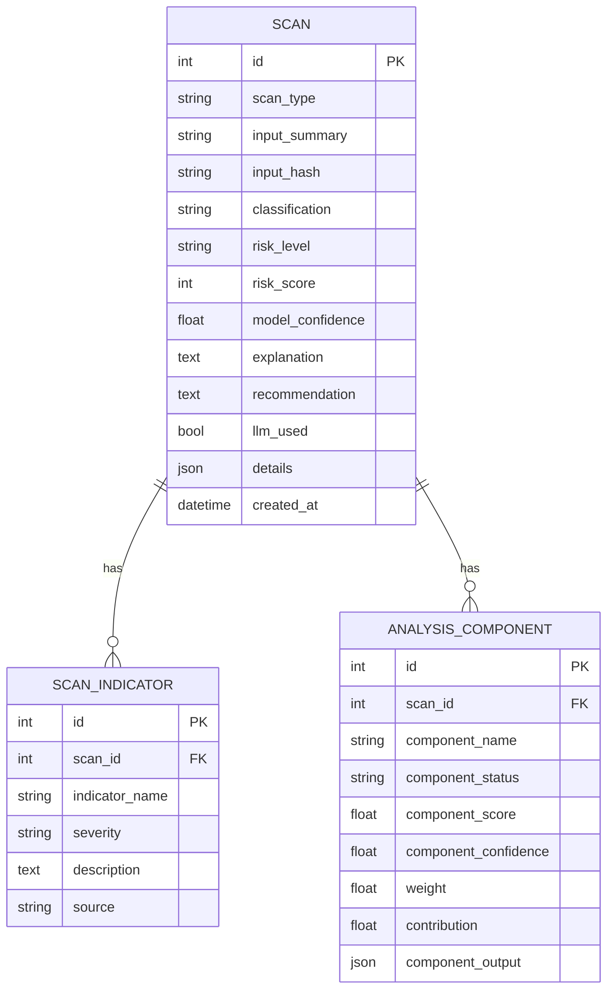

# Architecture

Last updated: 2026-11-18

## 1. Context

PhishGuard AI is a single-machine academic deployment: a React SPA talks to a FastAPI backend over
`/api/v1`. The backend owns all analysis, persistence and model loading. There is no external
service dependency at runtime except the **optional external** LLM provider, which is disabled by
default. Semantic analysis runs locally by default through a fine-tuned DistilBERT classifier.



## 2. Backend modules

| Package | Responsibility |
|---|---|
| `app/api/` | Routers, dependency wiring, request/response boundaries |
| `app/core/` | Pydantic settings (env-driven), logging |
| `app/database/` | SQLAlchemy engine/session factory |
| `app/models/` | ORM: `Scan`, `ScanIndicator`, `AnalysisComponent` |
| `app/schemas/` | Pydantic v2 request/response contracts |
| `app/agents/` | Pipeline stages; each has `analyze(...) -> dict` |
| `app/services/` | URL/email/graph/LLM analysis, risk aggregation, persistence |
| `app/ml/` | Artifact registry, URL feature extraction, popularity loader |
| `app/nlp/` | Text normalisation, URL extraction, email rules |
| `app/graph/` | Graph utilities |
| `app/utils/` | Hashing, redaction, truncation |

### 2.1 Orchestration

`AnalysisOrchestrator` (`app/agents/pipeline.py`) composes stages and isolates failures:

1. **InputAgent** — truncates input, extracts URLs, computes a SHA-256 input hash and a short summary.
2. **URLAnalysisAgent** — for each URL: lexical features → URL model → deterministic rules.
3. **EmailAnalysisAgent** — normalises text → TF-IDF model → social-engineering rules; re-runs rules
   with URL evidence.
4. **DomainIntelAgent** — queries the NetworkX graph for every host and the sender domain.
5. **SemanticAgent** — calls `SemanticRouter`: local DistilBERT first, external API only as an
   explicit fallback. Returns `unavailable` when neither is configured.
6. **RiskAggregationAgent** — weighted mean over available modules + corroboration bonus.
7. **ExplanationAgent** — deterministic natural-language explanation and recommendation.
8. **ResponseAgent** — assembles the response contract and timing metadata.

Every stage is wrapped in `try/except`; a failure produces an `error` component and the scan
continues. If **no** component produces a score, the API returns `503`.

### 2.2 Component contract

All analysis modules return the same dict shape (validated by `ComponentOut`):

```json
{
  "name": "url_model",
  "label": "URL ML classifier",
  "status": "ok",
  "score": 99.8,
  "confidence": 0.998,
  "explanation": "The URL classifier (...) estimated a 99.8% probability ...",
  "details": {"algorithm": "...", "probability": 0.998, "probability_raw": 0.998}
}
```

`status` is one of `ok`, `degraded`, `no_data`, `unavailable`, `error`, `skipped`.

## 3. Risk aggregation

Only components with `status == "ok"` and a non-null score participate.

```
base = Σ (w_i / Σ_available w_j) · score_i
high_signals = [i : score_i ≥ 60]
bonus = min(8, 4 · (len(high_signals) − 1))     if len(high_signals) ≥ 2
risk = round(clamp(base + bonus, 0, 100))
```

Default weights: email model 0.30, URL model 0.30, email rules 0.15, URL rules 0.10, graph 0.05,
LLM 0.10. Missing modules are **excluded**, never treated as zero.

| Score | `classification` | `risk_level` |
|---:|---|---|
| 0–29 | safe | low |
| 30–59 | suspicious | suspicious |
| 60–79 | phishing | high |
| 80–100 | phishing | critical |

`model_confidence` is the maximum confidence among available ML components; it is **not** the risk
score.

## 4. Storage model



The full email body is never written to the database. `details` stores the subject summary, sender
domain, redacted extracted URLs, counts, feature dictionary (URL scans), stage errors and notices.

## 5. Frontend

- React 18 + TypeScript strict mode, Vite 5, React Router 6.
- Tailwind CSS 3 with dark tokens in `src/index.css`.
- Recharts for dashboard charts, Lucide for icons.
- `src/services/api.ts` is the only HTTP layer; it throws a typed `ApiError` with validation issues.
- Pages: Dashboard, Email Scanner, URL Scanner, Scan History, Scan Detail, About & Limits, 404.
- Every data view implements loading, error and empty states.
- In development Vite proxies `/api` to `127.0.0.1:8000`; in production FastAPI serves `frontend/dist`.

## 6. Configuration

`app/core/config.py` defines a `Settings` model read from environment variables or `.env`.
Important settings: database URL, CORS origins, artifact directory, component weights, thresholds,
local LLM enable/max length/device (`LOCAL_LLM_ENABLED`, `LOCAL_LLM_MAX_LENGTH`,
`LOCAL_LLM_DEVICE`), external LLM enable/key/model/base URL/timeout, and `URL_POPULARITY_CALIBRATION`.

## 7. Security and privacy controls

| Control | Implementation |
|---|---|
| No URL fetching | Only `urllib.parse`-based parsing; no HTTP client call accepts submitted URLs |
| No attachment execution | Attachments are ignored during dataset build and never accepted by the API |
| Input size limits | Subject 500 chars, body 50 000 chars, URL 2 048 chars, ≤10 URLs/request |
| SSRF surface | No outbound request is made for user input at all |
| Secrets | Environment variables only; `.env` gitignored |
| Body minimisation | Summary + hash + derived features persisted |
| Local LLM privacy | DistilBERT inference happens in-process; `llm_sent_to_provider=false` and the response discloses the local backend |
| External LLM opt-in | Requires `LLM_ENABLED=true` **and** `LLM_API_KEY`; used only when local model is unavailable |
| Prompt injection | For the external path, email is JSON data inside a user message; system prompt forbids instruction-following; output strictly schema-validated |
| CORS | Explicit configured origins, no wildcard by default |

## 8. Failure behaviour

| Failure | Behaviour |
|---|---|
| Model artifact missing/corrupt | `ModelUnavailable`; component becomes `unavailable`; rules continue |
| Graph artifact missing | Graph component becomes `no_data`; risk uses remaining modules |
| Local LLM artifact missing or torch unavailable | `unavailable` component, excluded from risk; external API fallback used only if configured |
| Local LLM inference error | `unavailable` component; scan continues with rule/model evidence |
| External LLM disabled | `unavailable` component, zero network calls |
| External LLM timeout/5xx | One retry, then `unavailable` with error detail |
| External LLM invalid JSON/schema | Rejected, `unavailable`; scan continues |
| Malformed URL | Rule engine returns a 50-point `Malformed URL` indicator; model marked unavailable |
| Database error | Health reports `degraded`; analysis errors return a generic 500 without leaking internals |

## 9. Known architectural limitations

- SQLite is single-writer; not suitable for horizontal scaling.
- No authentication/authorisation layer (single-user academic demo).
- Static graph and models; no retraining loop, no streaming ingestion.
- No migration framework; schema created with `create_all`.
- Frontend bundle is a single chunk (~660 kB) because Recharts is bundled eagerly.
